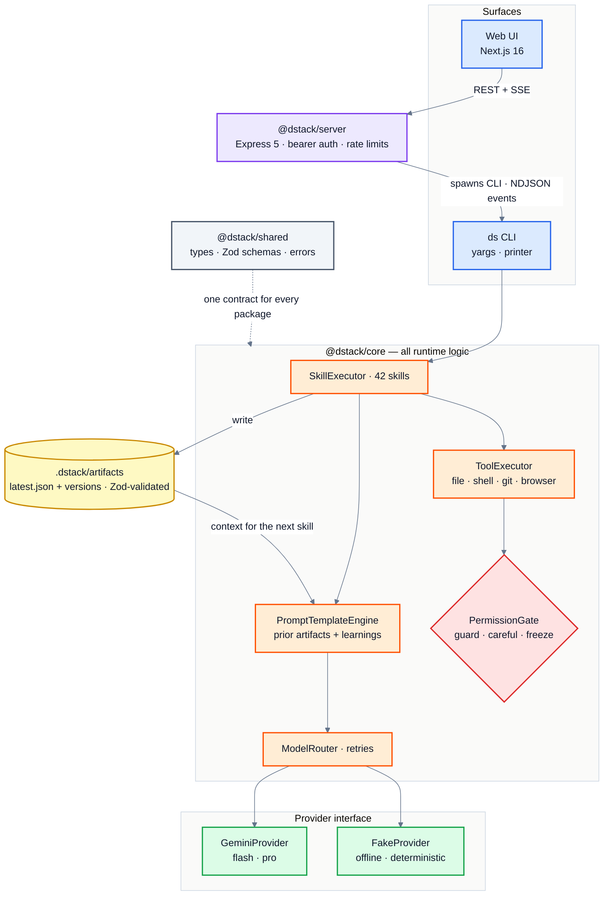
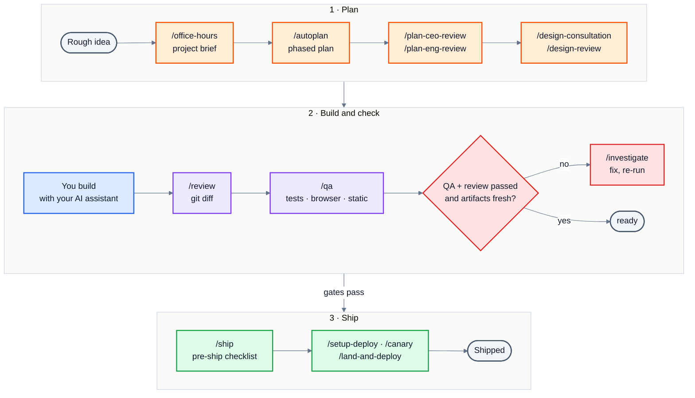
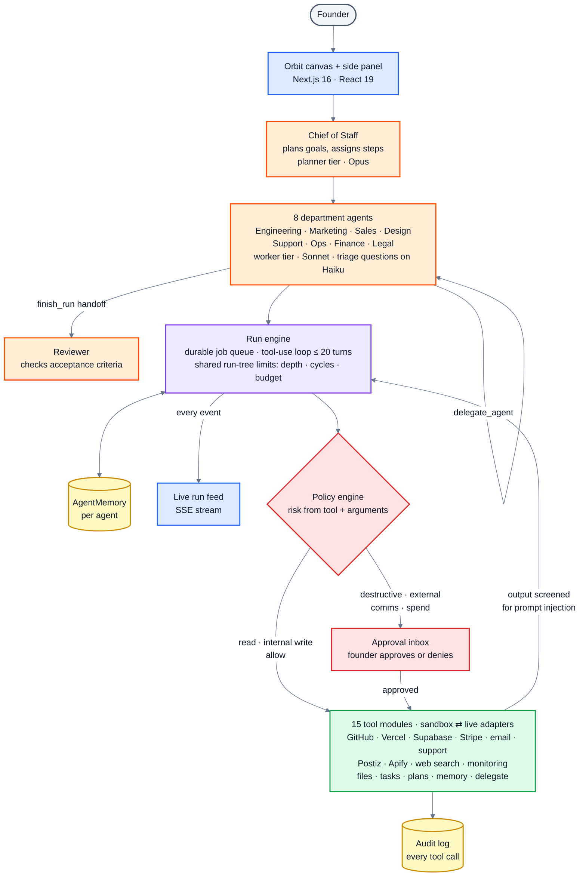
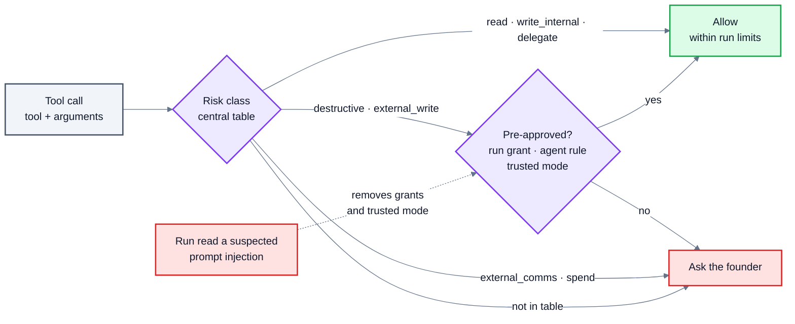
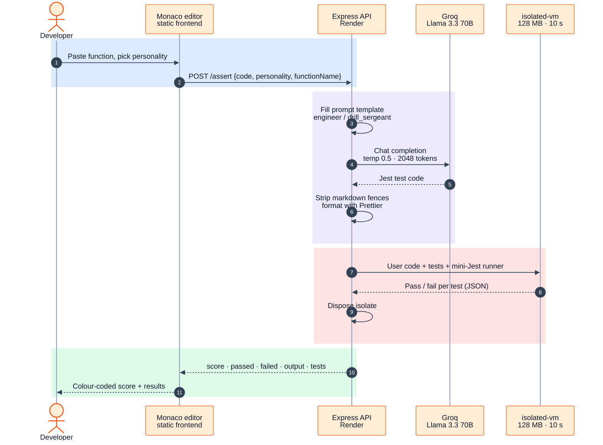
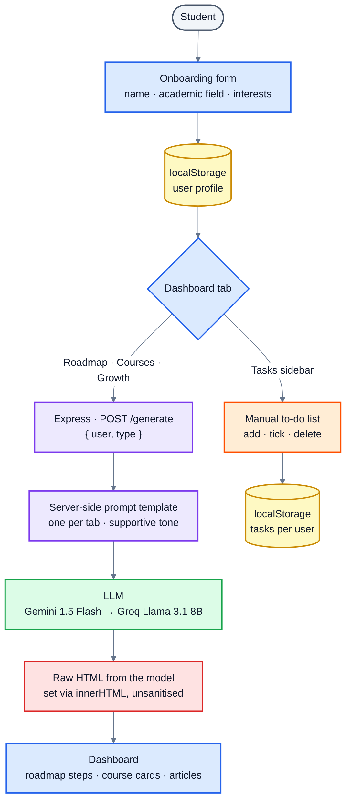

# Case-study TODOs: answers for all 14

**Portfolio:** `dharma-phi.vercel.app` · **Prepared:** 2026-10-15 · **Source:** the code in `dhrma-tech/DSTACK`, `STEVE`, `Vexor.AI` and `career_copilot` as pushed to GitHub, plus your LinkedIn text.

Every answer below is paste-ready MDX that replaces one `<Todo>` block. Most of it comes straight from the code and the repo docs. Lines marked **⚠ confirm** are my reading of *why* you did something. The code shows what you did, not why, so check those before publishing.

**Diagram colours** (the same in every diagram):

| Colour | Means |
|---|---|
| 🟦 Blue | What the user sees (UI, editor, CLI) |
| 🟪 Purple | Server, API and run engine |
| 🟧 Orange | Core logic and agents |
| 🟩 Green | Models, providers and the tools that act |
| 🟥 Red | Gates, approvals and risk points |
| 🟨 Yellow | Storage (artifacts, memory, logs) |

The Mermaid diagrams render in GitHub, VS Code and Obsidian. The site doesn't render Mermaid, so each one also comes as a PNG at the path shown under it (in `portfolio-diagrams.zip`).

---

## Summary

| # | Project | TODO | Status |
|---|---|---|---|
| 1 | DStack | Problem rewrite | ✅ ready · one ⚠ line |
| 2 | DStack | Architecture diagram | ✅ 2 diagrams |
| 3 | DStack | Monorepo trade-offs + why Gemini | ✅ ready · one ⚠ line |
| 4 | STEVE | Problem expansion | ✅ ready |
| 5 | STEVE | Architecture diagram | ✅ 2 diagrams |
| 6 | STEVE | Decisions: model, streaming, tools | ✅ ready (all from code) |
| 7 | Vexor.AI | Problem expansion | ✅ ready |
| 8 | Vexor.AI | Request-flow diagram | ✅ 1 diagram |
| 9 | Vexor.AI | Sandboxing, API, deployment | ✅ ready (all from code) |
| 10 | Vexor.AI | Results + what I'd change | ⚠ needs usage numbers, if any |
| 11 | Career Copilot | Problem expansion | ✅ ready · ⚠ confirm |
| 12 | Career Copilot | Input → prompt → roadmap → tasks diagram | ✅ 1 diagram |
| 13 | Career Copilot | Prompt and product decisions | ✅ ready · one ⚠ line |
| 14 | Career Copilot | Results and lessons | ⚠ needs outcome / usage, if any |

---

## Read first: what the code says that the site gets wrong

> [!WARNING]
> **1. Vexor.AI doesn't use Gemini.** `server.js` calls **Groq** with **Llama 3.3 70B** (`groq-sdk`). The site lists the stack as just `JavaScript`. Update the frontmatter:
> `stack: [JavaScript, Node.js, Express, Groq · Llama 3.3 70B, isolated-vm, Monaco]`

> [!WARNING]
> **2. Career Copilot doesn't call Gemini any more.** The README says "Gemini 1.5 Flash", but `server.js` calls **Groq `llama-3.1-8b-instant`**, using an env var that's still named `GOOGLE_API_KEY`. So it started on Gemini and moved to Groq. The site says "using the Google Gemini API" and `stack: [Gemini API, CSS]`. Suggested fix:
> `description: …guides students through their career and education journey with an LLM (started on Gemini 1.5 Flash, now Groq Llama 3.1).`
> `stack: [JavaScript, Node.js, Express, Groq · Llama 3.1 8B, localStorage]`

> [!CAUTION]
> **3. Vexor.AI's core feature is broken in the pushed code.** In `server.js`, the sandbox template has a corrupted line, `${85 (/require…/g, …)}` (around line 85), where `${testCode.replace(…)}` should be. The test-runner loop header (`for (const t of tests) {`) is also missing. Every `/assert` call would fail with `85 is not a function`. Fix it before anyone clicks "Source on GitHub", or say in the case study that the repo is archived.

> [!NOTE]
> **4. Career Copilot's tasks aren't generated from the roadmap.** The TODO asks how input becomes "a roadmap and tracked tasks". In the code, tasks are a separate manual to-do list in `localStorage`. The diagram and copy below show that honestly.

> [!NOTE]
> **5. STEVE's "Still ahead" line is partly out of date.** The Prisma schema is now `postgresql`, and the repo has 33 `*.test.ts` files. The site still says "Still ahead: a production database, fuller automated test coverage". Change it to "Still ahead: a production deploy and real user traffic" if that's where things stand.

---

## DStack (`content/projects/dstack.mdx`)

### 1 · Problem (replaces the `<Todo>` at line 19)

```mdx
Building with AI assistants is fast but shapeless. A solo developer or student goes from idea to code in one long chat: no written plan, no review, no QA, and nothing that stops you shipping something nobody checked. Every new session starts from zero, so the decisions you made yesterday are gone.

Garry Tan's GStack showed a better shape: named, opinionated steps like `/office-hours`, `/review`, `/qa` and `/ship`. But it lives on top of Claude. I wanted the same discipline as a standalone, CLI-first tool with its own state, hard gates between stages, and Google's models underneath.
```
⚠ confirm the second paragraph. It's built on your GitHub description: *"inspired by Garry Tan's GStack, built on Google API models rather than Claude"*.

### 2 · Architecture (replaces the `<Todo>` at line 33)

**How a skill runs.** The terminal and the web UI share one execution path:



**The pipeline and its gates.** This is what "structured" means in practice:



Paste into the MDX:

```mdx
<Figure src="/projects/dstack/pipeline.png" alt="The DStack pipeline: plan, build and check, ship. /ship is blocked until QA and review pass and no artifact is stale." width={2168} height={1212} />

<Figure src="/projects/dstack/architecture.png" alt="How a skill runs: CLI or web UI, SkillExecutor, prompt built from prior artifacts, Gemini or fake provider, permission-gated tools, Zod-validated artifacts." width={2060} height={2940} />

Every skill reads the artifacts of the skills before it, calls the model through one provider interface, runs its tools through a permission gate, and writes a versioned JSON artifact that the next skill reads. The web UI doesn't have its own copy of the logic. The server spawns the same CLI and streams its events back over SSE.
```

### 3 · Trade-offs: monorepo and Gemini (replaces the `<Todo>` at line 40)

```mdx
- **Artifacts are the contract between skills.** Each skill writes `latest.json` plus an append-only version, validated against a Zod schema. If validation fails, the run retries once with the errors fed back, then saves the result marked invalid instead of passing bad data down the pipeline.
- **One shared contracts package.** `@dstack/shared` holds only types, Zod schemas and typed errors. The CLI, server and web app all import the same schemas, so what the CLI writes is exactly what the UI expects. The cost is build order: `shared` has to build before anything else will typecheck.
- **All logic in `core`; thin CLI and server.** The server doesn't import `core` to run a skill. It spawns the CLI and turns its NDJSON events into SSE. The terminal and the browser then share one execution path, and a crashing run can't take the server down. The price is a process start per run and an event protocol to maintain.
- **Why Gemini first.** I wanted DStack to stand on its own rather than be another layer on Claude. Gemini's two tiers map cleanly onto the work: Flash for quick skills (`/office-hours`, `/ship`, `/browse`), Pro for the heavy reasoning (`/autoplan`, `/review`, `/qa`). It can also return JSON against a schema, which fits artifacts that get validated anyway.
- **Provider-agnostic from day one.** Gemini sits behind a `Provider` interface that streams chunks. The fake provider proves the seam is real, so adding Claude or OpenAI means writing one more class, not a rewrite.
```
⚠ confirm: if cost was a reason (Google AI Studio's free tier), add it to the Gemini bullet.

---

## STEVE (`content/projects/steve.mdx`)

### 4 · Problem (replaces the `<Todo>` at line 19)

```mdx
A solo founder has to be eight people at once: engineer, marketer, salesperson, designer, support, ops, finance and legal. Hiring isn't an option early on, so most of that work gets done badly or not at all.

AI chat assistants give advice but don't do the work. They can't open the pull request, deploy the site, create the Stripe product or answer the customer. Autonomous agents that *can* act have the opposite problem: nobody checks them before they email a customer, spend money or delete something. STEVE is for solo founders and very small teams who want the work delegated without giving up the final say.
```

### 5 · Architecture (replaces the `<Todo>` at line 34)

**The whole system.** Founder → Chief of Staff → departments → run engine → policy → tools:



**The approval policy.** One decision per tool call, made from the tool and its arguments only:



Paste into the MDX:

```mdx
<Figure src="/projects/steve/architecture.png" alt="STEVE: the Chief of Staff plans and assigns, eight department agents work through a durable run engine, every tool call passes a policy engine, and risky calls wait in the founder's approval inbox." width={2168} height={3234} />

<Figure src="/projects/steve/approval-policy.png" alt="How STEVE decides each tool call: reads and internal writes run, destructive and external writes need approval unless pre-approved, messages and spending always ask." width={2168} height={868} />
```

### 6 · Reasoning, model choice, streaming and tool design (replaces the `<Todo>` at line 41)

```mdx
- **Risk comes from the call, not from the model's words.** One central table classifies every tool. Reads and internal writes run. Destructive and external writes need approval unless the founder pre-approved them. Contacting people and spending money ask *every* time, and no rule can waive that. A tool missing from the table defaults to asking, so a new tool can never run silently. Because the decision never reads text the model wrote, a prompt injection can't talk its way past it.
- **Injected content tightens the rules.** Tool output is screened for prompt-injection patterns. A suspicious hit is wrapped as untrusted data, logged for the founder, and removes every convenience for the rest of the run: no run grants, no auto-approve rules, no trusted mode.
- **Per-agent memory.** Each department keeps its own persistent memory, so prompts stay focused and one agent's notes don't leak into another's work.
- **Model tiers in config, not code.** The Chief of Staff plans on Opus at high effort. Department agents and the Reviewer work on Sonnet. Quick agent-to-agent questions go to Haiku. Each tier has a fallback model, environment variables can override any of them, and a single agent can be pinned to a model. The router also supports OpenAI and a local Ollama fallback.
- **Everything streams.** Every run event goes to an event log and streams to the UI over SSE. Approvals raised deep inside a delegated child agent bubble up to the run the founder is watching.
- **Tools built for retries and runaways.** All agents in one delegation tree share limits on depth, cycles and budget, so a chain of agents stops as a whole. An identical outside-effect call inside one run is skipped, because a repeat is almost always a retry, not intent. Every call has a timeout and lands in the audit log with the agent as the actor.
- **Structured handoffs.** A delegated run ends by calling `finish_run` with a fixed shape that the engine validates and adds the real cost to, so the parent agent gets data it can act on, not a paragraph.
- **Durable runs.** Runs advance one step per job on a database-backed queue, so they survive restarts and can stay paused for as long as an approval takes.
```

---

## Vexor.AI (`content/projects/vexor-ai.mdx`)

> Fix the frontmatter stack first (see Read first, item 1).

### 7 · Problem (replaces the `<Todo>` at line 19)

```mdx
Writing thorough unit tests is tedious, and under pressure (a hackathon, a deadline) edge cases are the first thing to go. You test the inputs you had in mind when you wrote the function, which are exactly the ones least likely to break it.

I wanted a sparring partner: paste a function, get a test suite written by someone trying to break it, and see straight away which tests it fails.
```

### 8 · Request flow (replaces the `<Todo>` at line 27)



```mdx
<Figure src="/projects/vexor-ai/request-flow.png" alt="Vexor request flow: the Monaco editor posts code to the Express API, Groq's Llama 3.3 70B writes Jest tests, they run in an isolated-vm sandbox, and the score and results come back." width={2168} height={1586} />
```

### 9 · Sandboxing, API calls and deployment (replaces the `<Todo>` at line 31)

```mdx
- **Sandbox.** User code and the generated tests run inside `isolated-vm`: a separate V8 isolate with no Node APIs, so no file system, network or `require`. It's capped at 128 MB of memory and 10 seconds, and disposed after every run.
- **A mini Jest instead of real Jest.** Jest can't run inside an isolate, so the server injects a small runner that implements `describe`, `test` and the common matchers (`toBe`, `toEqual`, `toBeTruthy`, `toBeFalsy`, `toThrow`) and returns pass/fail per test as JSON.
- **Personalities as prompt templates.** "Senior Engineer" writes balanced tests; "Drill Sergeant" goes after edge cases, invalid inputs and boundaries. Both tell the model to return only code and to ignore any instructions hidden in the user's code.
- **Cleaning model output.** Markdown fences are stripped and the tests are run through Prettier before they execute, which catches most formatting noise from the model.
- **API keys stay on the server.** The Groq key is read from the environment, and the server refuses AI requests with a clear error if it's missing. Generation runs on Llama 3.3 70B through Groq.
- **Deployment.** The Express backend runs on Render's free tier from a `render.yaml` blueprint. The frontend is static files that call it.
```

### 10 · Results and what I'd do differently (replaces the `<Todo>` at line 37)

```mdx
It didn't finish perfectly, and the gaps taught me as much as the parts that worked.

- **Run tests in a real runner.** The mini Jest covers five matchers and no async tests. Next time: real Jest in a short-lived container.
- **Ask for structured output.** Stripping code fences from free text is fragile. A JSON response with the tests as a field is safer to parse.
- **Harden the API before sharing it.** CORS is open and there's no rate limiting, so anyone could spend the API budget.
- **Plan for cold starts.** On Render's free tier the first request after idle is slow, which hurts a tool whose whole point is instant feedback.
- **More than JavaScript.** Only JavaScript is supported. Python is the obvious next language.
```
⚠ **Needs you:** any usage, such as demo users, a hackathon result or tests generated, goes on the first line.

---

## Career Copilot (`content/projects/career-copilot.mdx`)

> Fix the frontmatter description and stack first (see Read first, item 2).

### 11 · Problem (replaces the `<Todo>` at line 19)

```mdx
Most students pick a branch first and work out a career path later, from scattered videos, seniors' advice and generic "top 10 skills" lists. Those roadmaps ignore what you actually study and what you're actually interested in. Even a good plan stays a plan, because nothing turns it into small steps you can track.
```
⚠ confirm: this is the README's framing in your words. Add a personal line if you built it for a specific reason, such as a hackathon theme or your own branch choice.

### 12 · How input becomes a roadmap and tasks (replaces the `<Todo>` at line 31)



```mdx
<Figure src="/projects/career-copilot/flow.png" alt="Career Copilot flow: an onboarding form saves the profile locally, each dashboard tab sends it to a server-side prompt, the LLM returns HTML cards, and tasks are a separate local to-do list." width={1120} height={2514} />
```

### 13 · Prompt and product decisions (replaces the `<Todo>` at line 35)

```mdx
- **Three fixed prompts, kept on the server.** The browser sends only the profile and which tab it wants: roadmap, courses or growth. It can't send its own prompt, and the API key never leaves the server.
- **Course links are search URLs, not course URLs.** Models invent course links that don't exist. A search link on the recommended platform (for example, a Coursera search) always works.
- **The model returns ready-made HTML.** That was the fastest route to a polished dashboard in hackathon time: no client-side rendering logic. The trade-off is trusting model output on the page (see lessons).
- **No accounts; everything in `localStorage`.** No database and no sign-up, so a student is in within seconds and their data stays on their device. The cost is that nothing follows you to another device.
- **A supportive tone, on purpose.** Every prompt asks for an encouraging voice, because the audience is students who are often unsure about their path.
- **Switched from Gemini 1.5 Flash to Groq Llama 3.1 8B Instant** for faster responses.
```
⚠ confirm the reason for the switch. The code only shows that it happened.

### 14 · Results and lessons (replaces the `<Todo>` at line 39)

```mdx
Built in Sep–Oct 2025 as a hackathon project: an Express backend, a static frontend and an LLM working together end to end.

- **Ask for data, not markup.** Rendering model-written HTML straight onto the page is fast but unsafe and hard to restyle. Today I'd ask for JSON and render it myself, with sanitising.
- **Connect the plan to the action.** The roadmap and the task list are separate. Turning each roadmap step into tasks is the feature the product was really missing.
- **Keep the docs honest.** The README still says Gemini after the switch to Groq. Small, but it's the first thing a reviewer checks.
- **Know the trade-off of local-only.** `localStorage` made it frictionless and private, but a student loses everything on a new device.
```
⚠ **Needs you:** a hackathon result or any usage numbers go on the first line.

---

## What I need from you

1. **Vexor.AI:** fix `server.js` (Read first, item 3) or mark the repo archived. This decides whether "Source on GitHub" stays.
2. **Why Gemini for DStack:** was cost or the free tier part of it? (#3)
3. **Why Career Copilot moved to Groq:** speed, free-tier limits or something else? (#13)
4. **Numbers:** any users, hackathon placings or demo results for Vexor.AI and Career Copilot. (#10, #14)
5. **STEVE "Still ahead" line:** is a production database now running? (Read first, item 5)

## Apply it

Put this file in the repo root, unzip the PNGs into `portfolio/public/projects/`, and give Claude Code this prompt:

```
Read CASE_STUDY_TODOS.md. In portfolio/content/projects/, replace each <Todo> block listed in it with the matching MDX snippet, add the <Figure> lines where shown, and apply the frontmatter fixes in "Read first" items 1, 2 and 5. Keep every line marked ⚠ confirm but list them for me at the end. Don't invent facts. Then run tsc, lint and build, open /projects/dstack, /projects/steve, /projects/vexor-ai and /projects/career-copilot to check the figures render, and commit as "content: fill case-study TODOs".
```
